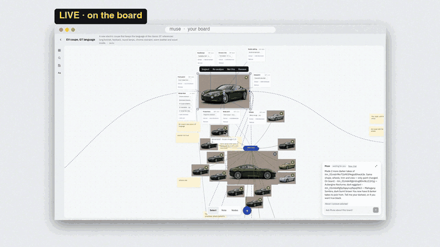
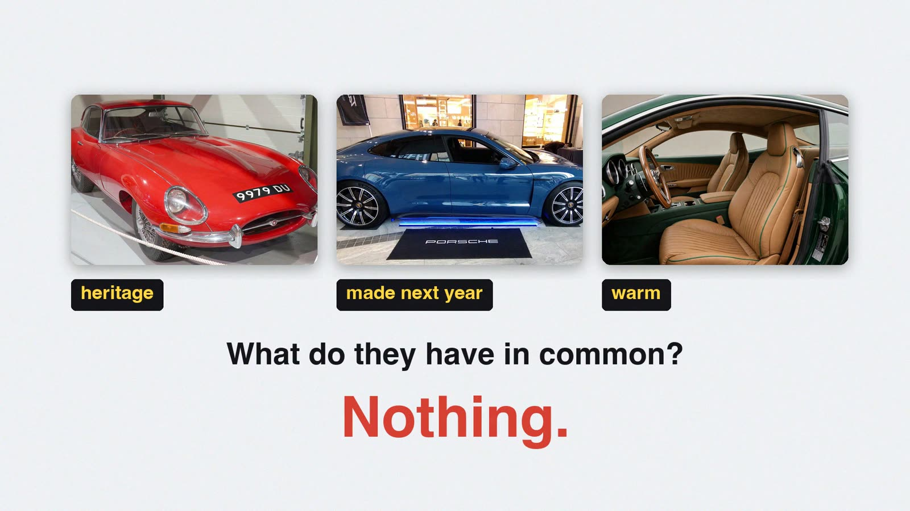
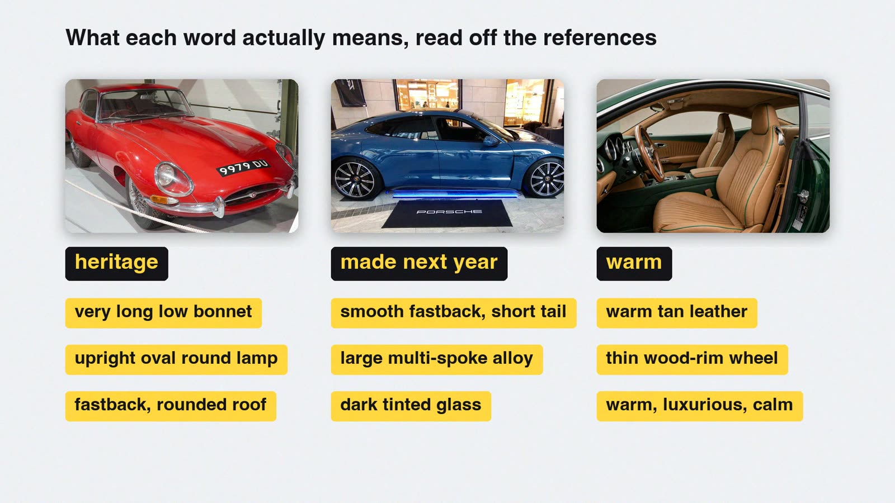
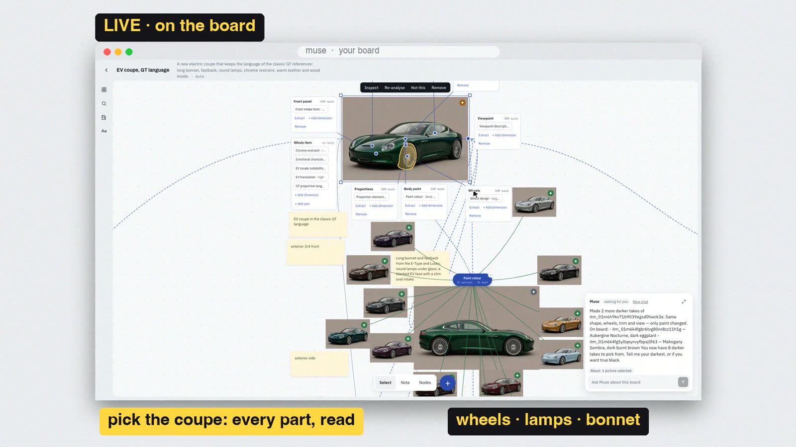
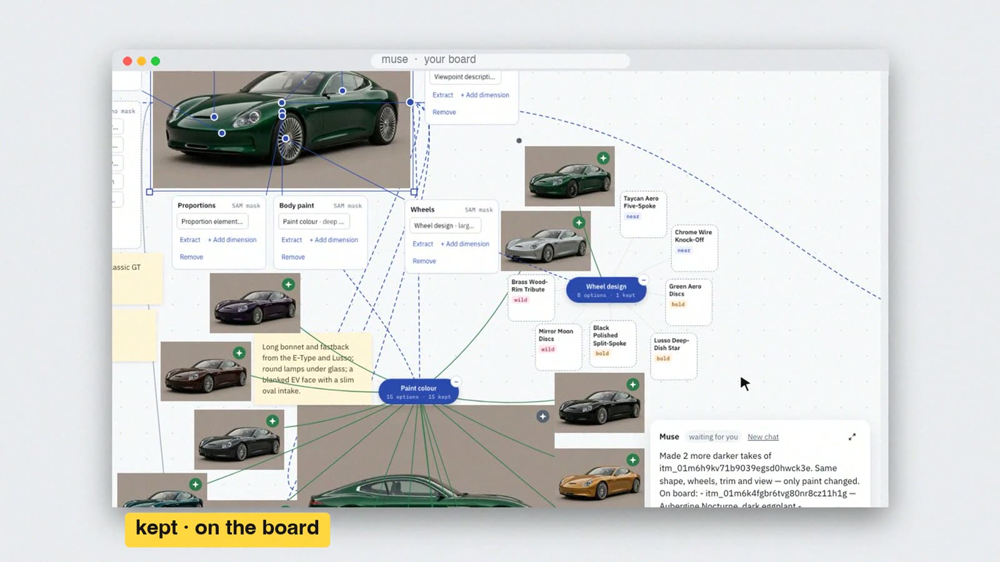
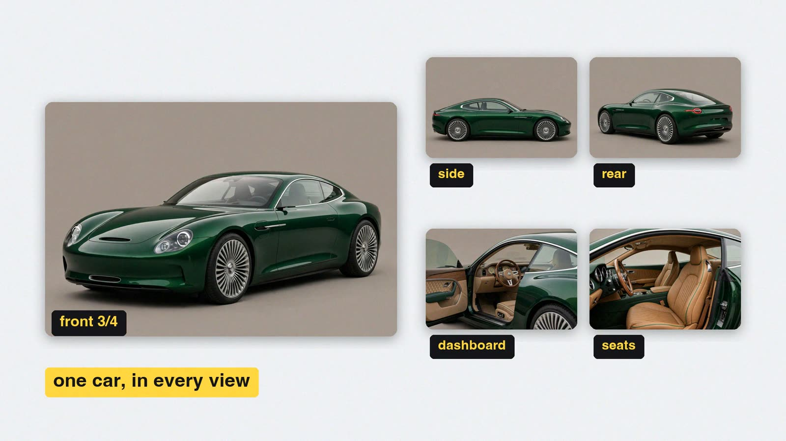
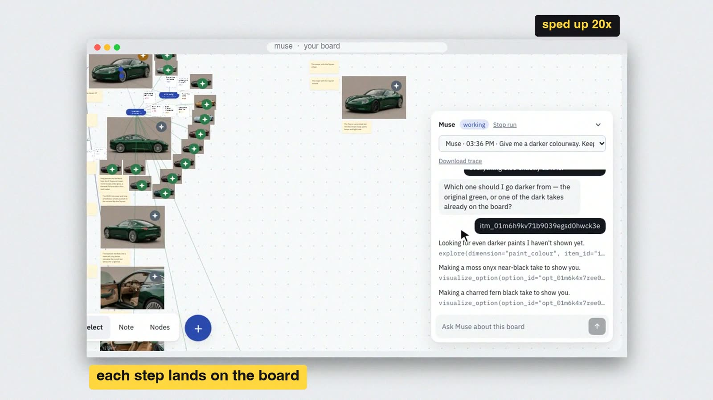
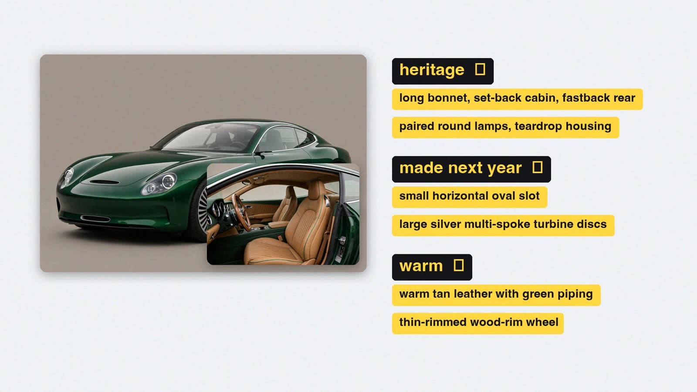
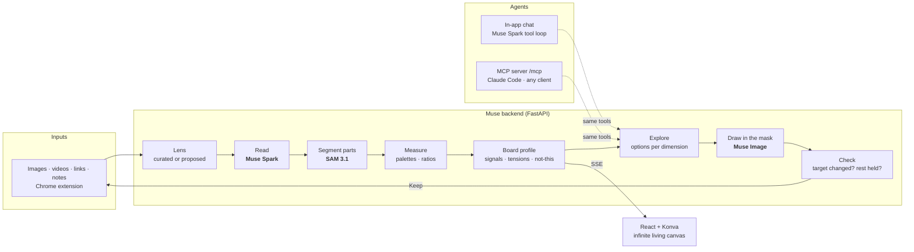

<div align="center">

# Muse

### Explore. Don't regenerate.

**A design board that reads your references the way a designer does, part by part, so you can change one thing and keep the rest.**

Built on Meta's models: **Muse Spark** reads, **SAM 3.1** finds the parts, **Muse Image** draws.




**[▶ Watch the 2:16 demo](https://youtu.be/eMNe0cv9KLM)** · [How it works](#how-it-works) · [Run it](#run-it-in-3-commands) · [Technical guide](docs/TECHNICAL.md)

</div>

---

## The problem

A car brand briefs an agency. Each of the three people in the room asks for something different:

> **Brand director:** "We're a 70-year-old company. Heritage is the whole point."
> **Marketing head:** "If it looks old, we're dead. It has to feel like it was made next year."
> **CEO:** "And warm. Our competitors are cold."

Each brought a reference. The three have nothing in common.



Today the designer types a prompt into an image model and hits **regenerate** over and over. Each
result is close but not right, and every attempt changes everything at once. The output is a
*supermarket of almost-right*, and agencies are drowning in generic AI slop.

**The designer doesn't need more images.** They need to push the one thing the client trusts in a
new direction without losing the other two. Boards can hold images and AI can make them, but
until now nothing in between understood *what is in them*.

## What Muse does

### 1. Reads what each word means, from the references themselves

Muse Spark reads every reference through a domain **lens** (cars, watches, fashion, interiors, UI,
or a lens it proposes for anything else). "Heritage" stops being a vibe and becomes *a very long
low bonnet, upright oval lamps and a rounded fastback roof*.



### 2. Finds every part on the picture

SAM 3.1 locates the parts the lens names. Select an item and its callouts appear around it: wheels,
lamps, bonnet and cabin, each with the dimensions Muse read. Colours are *measured* from the masks
(Lab palettes, ΔE2000), not guessed.



### 3. Changes one thing and checks the rest held

Click a dimension (say *wheel design*) and a **flower** of options grows beside the item. Open a
petal and Muse Image redraws **only inside that part's mask**. Every result is then **checked**:
did the target change, and did everything else stay the same? Keep it and it becomes an ordinary
item on the board, so the loop starts again from there.



### 4. Holds the design across every view

The same car can be drawn from the side, the rear, the dashboard and the seats, and it stays the
same car. You can also **put one picture into another**: drag from one picture to the parts of
another and Muse puts it in.



### 5. An agent that works the board, in the open

Ask in plain words, for example *"make it darker"*. Muse (a Muse Spark tool loop) works out which item
you mean, **asks when it is unsure**, and every step it takes lands on the board where you can see
and click it. No black box. The same tools are served over **MCP**, so Claude Code or any MCP
client can run a whole brief end to end: set the goal and deliverables, add references, explore,
draw, lay out the output sheet and finish.



### The result: one car that answers all three asks



Every ask traces to specific parts: heritage to the long bonnet and paired round lamps, made next
year to the oval slot and turbine discs, warm to tan leather with green piping and a wood-rim
wheel.

---

## Demo

| | |
|---|---|
| 🎬 **Video (2:16)** | [youtu.be/eMNe0cv9KLM](https://youtu.be/eMNe0cv9KLM) |
| 🗂 **Real recorded boards** | Four boards (car, UI, interior, fashion) were driven end to end by the agent and recorded. Run logs and screenshots are in [`reports/demo/`](reports/demo/). |
| 🔁 **Replay a run** | Open any board with `?replay=<run_id>` to watch the agent's steps play back on the canvas. |

The **LIVE** shots in the video are screen recordings of the real app working on a copy of the car
board, not mock-ups.

---

## How it works



| Meta model | What Muse uses it for |
|---|---|
| **Muse Spark** (`muse-spark-1.3`) | Reads each item through the lens into typed, schema-constrained attributes with confidence and evidence. Proposes lenses for new domains, proposes explore options, rewrites notes, runs the result checks and drives the in-app agent loop. |
| **SAM 3.1** | Segments the parts the lens names (images and video key frames). Its masks drive measurement, callouts and where edits are allowed. |
| **Muse Image** (`muse-image-1.0`) | Edits inside a part's mask, redraws the whole picture from another viewpoint, and puts one picture's subject into another. |
| SigLIP 2 (local) | Embeddings for domain voting and similarity. Meta has no embeddings endpoint, so this one runs on-device. |

### What makes it more than a wrapper

- **Typed reading, not captions.** A lens has at most 8 parts and 20 attributes of seven kinds (enum, ordinal, number,
  boolean, colour, text, shape). Values below a reliability threshold count as *unknown*, and unknown never matches.
- **Measured where it can be.** Colour and ratio values are computed from SAM masks rather than asked of the LLM.
- **The board learns.** Per-attribute distributions become *signals* (≥3 known, ≥60% agree), *tensions*
  (two values ≥30% each) and *counter-signals* from items marked "not this". These stream live over SSE.
- **Every generation is verified.** The check asks whether the target dimension changed and whether the others held, and failures
  are reported honestly instead of being hidden. The agent's `finish` refuses a sheet that fails its checks.
- **One tool registry, three front ends.** The UI, the in-app agent and the MCP server all call the same
  tools, so whatever an agent does, you can do by hand, and the reverse.
- **A living canvas.** Items drift gently, make room for each other and come back to the positions you saved.

---

## Run it in 3 commands

Requirements: Python 3.12 with [uv](https://docs.astral.sh/uv/), Node 20 or later.

```sh
make install   # backend + frontend deps; creates .env from .env.example
make seed      # fixture corpus + four demo boards
make dev       # API → http://localhost:8000 · app → http://localhost:5173
```

**Offline (no key):** set `REASONING_PROVIDER=mock SEGMENTATION_PROVIDER=mock EMBEDDER=mock
IMAGE_PROVIDER=mock` in `.env`. Every feature runs end to end on deterministic mocks.

**Live:** put a Meta Model API key in `MODEL_API_KEY`, set `IMAGE_PROVIDER=muse-image`, and run
`make smoke` to check each model responds.

**Drive it from Claude Code:**

```sh
MCP_ENABLED=1 make dev
claude mcp add --transport http muse http://localhost:8000/mcp
```

Then give it a brief, for example: *"Create a board called EV coupe, goal 'a two-door electric
coupe', deliverables: front three-quarter, side profile, interior, colour option. Visualize each, lay
out the output sheet and finish."*

The full configuration, keys, deploy guide and API notes are in **[docs/TECHNICAL.md](docs/TECHNICAL.md)**.

---

## Engineering

| | |
|---|---|
| Backend | Python 3.12 · FastAPI · SQLite + Alembic · NumPy (no vector DB) · in-process job pool · SSE |
| Frontend | React 19 · Vite · react-konva infinite canvas · TypeScript |
| Agents | MCP server (streamable HTTP) · in-app Muse Spark tool loop · full step traces |
| Extras | Chrome MV3 extension (right-click → Add to board) · plugin nodes (Palette, Critique, your own) · board export/import bundles · public demo mode (read-only until unlocked) |
| Tests | **1,261 backend** (pytest) · **638 frontend** (vitest) · **14 extension**, all passing on 2026-11-04 · plus an offline Playwright e2e suite |
| History | 350+ commits from 2026-10-26 to 2026-11-04 ([build log](docs/BUILD_LOG.md)), each feature designed, planned and reviewed in [`docs/superpowers/`](docs/superpowers/) |

```
backend/     FastAPI engine: providers, lenses, analysis, explore, render, put, views, agent, MCP
frontend/    React + Konva board app
extension/   Chrome extension: capture any image to a board
docs/        technical guide, plugin guide, design specs and plans, demo board briefs
reports/     recorded agent runs and the trailer pipeline
corpus/      licensed fixture corpus and importers
```

## Known limits

- Single-user and local. Without demo mode there are no accounts, and the demo guard is a shared passcode.
- Thresholds (signal cut-offs, colour tolerances) are first guesses, not yet tuned on labelled data.
- Jobs run in-process, so a restart drops in-flight work (you retry it from the UI).
- Muse Image is geo-restricted in some regions under Meta's use policy. For a demo there, swap `IMAGE_PROVIDER`.

The full list is in [docs/TECHNICAL.md#known-limitations](docs/TECHNICAL.md#known-limitations).

---

<div align="center">

**Muse**: taste for AI exploration. Real boards, real runs.

Built by [@itskshivam1318](https://github.com/itskshivam1318) · © 2026, all rights reserved. Source is shared for hackathon judging.

</div>
